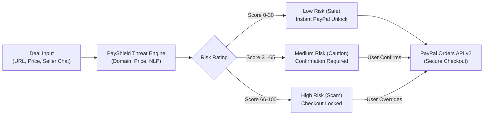

# PayShield

<div align="center">


[](https://github.com/akshdeepsingh7)
[](https://www.youtube.com/watch?v=060fg4GyTac)

[](https://render.com)


**AI-powered pre-payment scam protection for PayPal checkout.**

*Built by [**Akshdeep Singh**](https://github.com/akshdeepsingh7) ([PayShield-AI](https://github.com/PayShield-AI)) for the PayPal AI Hackathon 2026.*

</div>

---

## Overview

**PayShield** is an AI safety assistant that helps online shoppers avoid payment scams before they send money. 

When someone is about to pay an unfamiliar seller, they enter the product link, price, and seller communication. PayShield inspects the deal for red flags—such as prices that look too good to be true, suspicious or brand-new domains, and pushy language that rushes payment. It delivers a clear risk rating (**Low**, **Medium**, or **High**) with a simple explanation in plain words, and safely gates checkout through the **PayPal Developer Platform (Orders API v2)**.

### Core Principles
- **PayPal handles all payments securely:** All transactions use official PayPal Sandbox v2 APIs with Buyer Purchase Protection.
- **The app never touches card details:** Zero sensitive cardholder data or credentials are stored or handled.
- **The user always makes the final decision:** Safe purchases unlock instant checkout; risky ones trigger a warning and require confirmation before proceeding.

---

## Architecture & System Workflow



---

## Demo Video

<div align="center">

[](https://www.youtube.com/watch?v=060fg4GyTac "Click here to watch the PayShield Demo on YouTube")

**[Watch Full Video Walkthrough on YouTube](https://www.youtube.com/watch?v=060fg4GyTac)**  
*Subscribe to updates on YouTube: [@Pay-Shield](https://www.youtube.com/@Pay-Shield)*

</div>

---

## Key Features

- **Domain & Website Authenticity:** Catches brand impersonation and typosquatting (e.g. `apple-clearance-outlet.shop`), suspicious top-level domains (`.top`, `.xyz`, `.shop`), and insecure HTTP connections.
- **Price Anomaly Analyzer:** Compares prices against real-world retail benchmarks to flag unrealistic discounts (80%+ off) commonly used in non-delivery scams.
- **Pushy Language & Urgency Detector:** Uses natural language processing to detect artificial countdown timers and attempts to bypass buyer protection (demands for *PayPal Friends & Family*, wire transfers, or crypto).
- **Intelligent Checkout Gating:**
  - **Low Risk:** One-click PayPal Checkout button unlocked immediately.
  - **Medium Risk:** Prompts an itemized checklist requiring user confirmation.
  - **High Risk:** Safety lock engaged with plain-language explanations; requires manual override.
- **PayPal Sandbox Orders v2 API:** Server-side OAuth2 token management, order creation with safety audit tags, and payment capture.
- **Cyber-FinTech Interface:** Responsive glassmorphic interface with real-time animated SVG risk gauge, Web Audio API sound cues, and `Ctrl + Enter` shortcut.
- **Zero-Config Demo Mode:** Includes a built-in sandbox simulator so anyone can test the full user journey immediately without needing API keys.

---

## Quick Start Guide

### Deploy to Render (Sponsored Hackathon Tool)

PayShield is pre-configured for **Render** (official sponsor of the PayPal AI Hackathon 2026). Deploy your own live instance instantly with one click using the included `render.yaml` blueprint:

[](https://render.com/deploy?repo=https://github.com/PayShield-AI/PayShield)

#### Render Web Service Settings (If Configuring Manually)
If creating a Web Service manually via the Render Dashboard:
- **Runtime:** Python
- **Build Command:** `pip install -r requirements.txt`
- **Start Command:** `gunicorn app:app` *(or `python app.py`)*
- **Environment Variables:**
  - `SERVER_HOST`: `0.0.0.0`
  - `PAYPAL_MODE`: `sandbox`
  - `PAYPAL_CLIENT_ID`: `sb` (or your PayPal Sandbox client ID)
  - `PAYPAL_CLIENT_SECRET`: (your PayPal Sandbox secret)

---

### Local Installation

#### Prerequisites
- Python 3.10 or higher
- Modern web browser

### 1. Clone the Repository
```bash
git clone https://github.com/PayShield-AI/PayShield.git
cd PayShield
```

### 2. Install Dependencies
```bash
pip install -r requirements.txt
```

### 3. Configure Credentials (Optional)
PayShield runs out of the box with an interactive sandbox simulator. To connect your real PayPal Developer Sandbox keys:
```bash
cp .env.example .env
```
Add your credentials in `.env`:
```env
PAYPAL_CLIENT_ID=your_sandbox_client_id
PAYPAL_CLIENT_SECRET=your_sandbox_client_secret
PAYPAL_MODE=sandbox

# Optional: Google Gemini API for extended reasoning
GEMINI_API_KEY=your_gemini_api_key
```

### 4. Start the Application
```bash
python app.py
```
Open **`http://127.0.0.1:5000`** in your browser.

---

## Test Scenarios

The dashboard includes 1-click test scenarios to evaluate PayShield instantly:

| Scenario | Details | Price | Risk Rating | Behavior |
| :--- | :--- | :---: | :---: | :--- |
| **iPhone 16 Pro Fake Store** | Disposable `.shop` domain, demands Friends & Family in 8 mins | $89.00 | **HIGH (93/100)** | Safety lock engaged; checkout locked |
| **Vintage Watch Reseller** | Personal seller, domain registered last week | $135.00 | **MEDIUM (42/100)** | Warning checklist; confirmation required |
| **Artisan Leather Goods** | Verified merchant, covered by PayPal Purchase Protection | $165.00 | **LOW (0/100)** | Instant 1-click PayPal checkout unlocked |

---

## API Endpoints

PayShield provides lightweight REST API endpoints:

- `POST /api/analyze` — Evaluates product link, price, and seller communication for scam indicators.
- `POST /api/paypal/create-order` — Creates a PayPal v2 order; enforces safety lock policy for high-risk transactions.
- `POST /api/paypal/capture-order` — Captures payment for approved PayPal orders.
- `GET /api/presets` — Returns pre-configured demo scenarios for quick testing.
- `GET /api/status` — Returns service health, active mode, and PayPal gateway status.

---

## Unit Tests

Run the test suite verifying domain analysis, price anomalies, language detection, and PayPal safety locks:

```bash
python -m unittest tests/test_engine.py
```
*(All 17 unit tests pass in ~0.03s).*

---

## Tech Stack

<div align="center">


</div>

- **Backend & Server:** Python 3, Tornado (Async Engine), Gunicorn (Production WSGI Server)
- **AI & Threat Engine:** Heuristic threat engine, statistical benchmark modeling, optional Google Gemini API
- **Payments:** PayPal Developer Platform (Sandbox Orders API v2)
- **Cloud & Hosting (Sponsored Tool):** Render (PaaS Web Service via `render.yaml`)
- **Frontend:** HTML5, Tailwind CSS, Web Audio API, SVG vector gauges

---

## Organization & Author

- **GitHub Organization:** [PayShield-AI](https://github.com/PayShield-AI)
- **Repository:** [PayShield-AI/PayShield](https://github.com/PayShield-AI/PayShield)
- **Cloud Infrastructure (Sponsored Tool):** Render
- **YouTube Channel:** [@Pay-Shield](https://www.youtube.com/@Pay-Shield)
- **Video Walkthrough:** [Watch on YouTube](https://www.youtube.com/watch?v=060fg4GyTac)
- **Developer:** [**Akshdeep Singh**](https://github.com/akshdeepsingh7) ([@akshdeepsingh7](https://github.com/akshdeepsingh7))
- **Hackathon:** PayPal AI Hackathon 2026 (*"Build What's Next with PayPal and AI"*)

---

## License

This project is licensed under the [MIT License](LICENSE).
